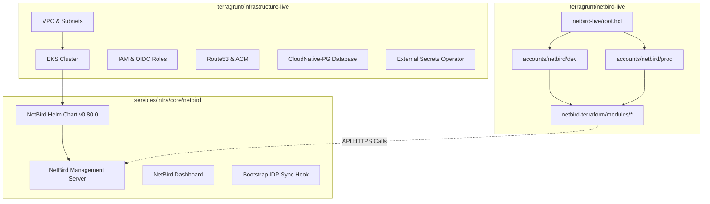
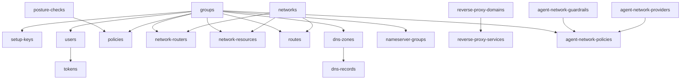
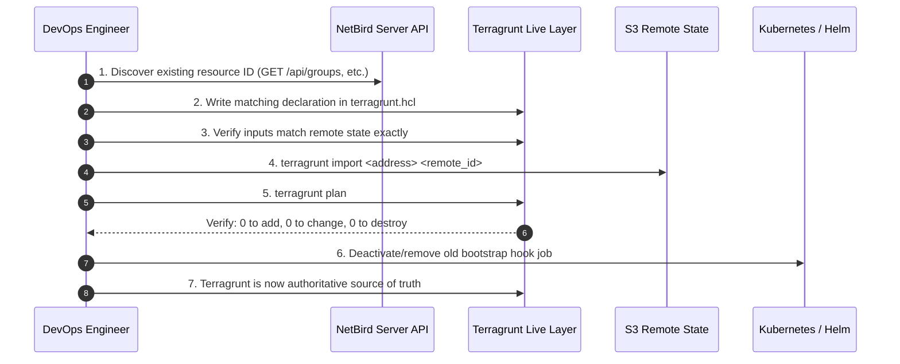

# NetBird Terragrunt Architecture & Dedicated Live Layer

**Date**: 2026-10-08  
**Repository**: `kioskOG/netbird-on-eks`  
**Live Layer Path**: `terragrunt/netbird-live/`  
**Target Modules**: `netbird-terraform/modules/`  
**Provider**: `registry.terraform.io/netbirdio/netbird` v0.0.10  
**Terraform Baseline**: `1.16.5` | **Terragrunt Baseline**: `1.1.6`

---

## 1. Architecture Overview

The platform establishes an independent, decoupled Infrastructure as Code architecture separating underlying cloud infrastructure from the NetBird overlay mesh layer:



### Decoupled Hierarchy

```
AWS Terraform/Terragrunt (infrastructure-live)
        │
        │ [Separate Ownership & State]
        ▼
NetBird Reusable Modules (netbird-terraform/modules)
        │
        ▼
NetBird Terragrunt Live Layer (terragrunt/netbird-live)
        │
        ▼
NetBird Management API (https://netbird.REPLACE_ME_DOMAIN)
        │
        ▼
Self-Hosted NetBird Platform (v0.80.0 on EKS)
```

---

## 2. Ownership Model

| Layer | Directory Path | Operational Ownership | Lifecycle & Tooling |
|---|---|---|---|
| **AWS Infrastructure** | `terragrunt/infrastructure-live/` | Cloud Platform / SRE | Manages VPC, Subnets, EKS, RDS, IAM, Route53, and KMS state. |
| **Kubernetes Workloads** | `services/infra/core/netbird/` | Kubernetes Operations | Manages Helm deployment of NetBird 0.80.0, Dashboard, and Ingress. |
| **NetBird Mesh Overlay** | `terragrunt/netbird-live/` | Network / SecOps / DevOps | Manages NetBird groups, users, policies, routing rules, DNS, and setup keys. |
| **Reusable NetBird Modules**| `netbird-terraform/modules/` | Engineering / Core Architecture | Environment-agnostic Terraform modules implementing provider v0.0.10 resources. |

---

## 3. Provider Configuration

- **Provider**: `registry.terraform.io/netbirdio/netbird`
- **Version Constraint**: `~> 0.0.10`
- **Provider Endpoint Attribute**: **`management_url`** (verified from schema; default: `https://netbird.REPLACE_ME_DOMAIN`).
- **Provider Authentication Attribute**: **`token`** (verified from schema; accepts Personal Access Tokens).
- **Environment Variable Fallbacks**:
  - `NB_MANAGEMENT_URL`: sets `management_url`
  - `NB_PAT`: sets `token`
  - `NB_ACCOUNT`: sets `tenant_account` (for multi-tenant impersonation)

### Externalized Provider Generation in `root.hcl`
To guarantee that credentials are never stored in HCL or captured in state configurations, child modules do not define provider blocks. Instead, Terragrunt dynamically generates the provider configuration:

```hcl
generate "provider" {
  path      = "provider.tf"
  if_exists = "overwrite_terragrunt"
  contents  = <<EOF
terraform {
  required_version = ">= 1.5.0"
  required_providers {
    netbird = {
      source  = "netbirdio/netbird"
      version = "~> 0.0.10"
    }
  }
}

provider "netbird" {
  management_url = "${local.management_url}"
  # Admin PAT is supplied externally via NB_PAT environment variable.
  # No credentials are hardcoded or tracked in version control.
}
EOF
}
```

---

## 4. State Architecture & Isolation

NetBird state is strictly isolated from AWS infrastructure state.

### S3 Remote State Backend
- **Bucket**: `${local.aws_account_name}-${local.env_name}-terraform-state` (e.g. `netbird-dev-terraform-state`).
- **State Key**: `${local.aws_account_id}/netbird/${path_relative_to_include()}/terraform.tfstate`.
- **KMS Encryption**: `encrypt = true` ensures AWS KMS server-side encryption is enforced on all state objects.
- **Locking**: `use_lockfile = true` provides native Terraform 1.10+ S3 state locking without requiring DynamoDB table overhead.
- **Logical State Isolation**:
  - AWS infrastructure state resides under: `<account_id>/us-east-2/.../terraform.tfstate`
  - NetBird overlay state resides under: `<account_id>/netbird/accounts/netbird/<env>/.../terraform.tfstate`
  - **Zero Collision Risk**: NetBird applies can never overwrite or lock AWS infrastructure state.

---

## 5. Secret Handling & Production Protections

1. **State Storage Reality**:
   Because Terraform state stores resource attributes (such as `scim.auth_token`, `setup_key.key`, and `token.token`) in plaintext JSON within the state file:
   - S3 bucket must enforce TLS (`aws:SecureTransport = true`).
   - S3 bucket must enforce AWS KMS encryption (`aws:kms`).
   - IAM policies must restrict read access to state files.
2. **Input Credentials**:
   - Upstream API keys (`agent-network-provider.api_key`) and IdP client secrets (`identity-provider.client_secret`) must be injected into execution environments via AWS Secrets Manager or CI/CD secrets runners, never committed in plain `.tfvars` or `.yaml`.
3. **Module Output Filtering**:
   - Child modules in `netbird-terraform/modules/` suppress sensitive inputs from output maps.
   - Generated tokens (`setup_keys`, `tokens`, `auth_token`) are exported only through outputs explicitly marked `sensitive = true`.

---

## 6. Naming Conventions

All resource names follow platform-mandated conventions constructed at the live layer:

| Resource Type | Standard Pattern | Live Dev Example | Live Prod Example |
|---|---|---|---|
| **Peers** | `peer-<team>-<env>` | `peer-devops-dev` | `peer-devops-prod` |
| **Services / Groups** | `svc-<app>-<tier>-<env>` | `svc-orders-web-dev` | `svc-orders-web-prod` |
| **Networks** | `net-<provider>-<region>-<env>` | `net-aws-use2-dev` | `net-aws-use2-prod` |
| **Policies** | `<source> -> <dest> [<protocol>/<port>]` | `peer-devops-dev -> svc-orders-web-dev [TCP/443]` | `peer-devops-prod -> svc-orders-web-prod [TCP/443]` |
| **Setup Keys** | `setup-<env>-<purpose>` | `setup-dev-k8s-nodes` | `setup-prod-k8s-nodes` |

---

## 7. Complete 24-Unit Live Layer Inventory & Dependency Architecture

The `terragrunt/netbird-live/` implementation provides 100% full coverage across all 24 NetBird modules:

| Unit Directory | Reusable Module | NetBird Resource | Paradigm | Terragrunt Dependencies |
|---|---|---|---|---|
| `account-settings` | `account-settings` | `netbird_account_settings` | Singleton | None |
| `dns-settings` | `dns-settings` | `netbird_dns_settings` | Singleton | None |
| `groups` | `group` | `netbird_group` | Collection | None |
| `setup-keys` | `setup-key` | `netbird_setup_key` | Collection | `groups` |
| `users` | `user` | `netbird_user` | Collection | `groups` |
| `tokens` | `token` | `netbird_token` | Collection | `users` |
| `networks` | `network` | `netbird_network` | Collection | None |
| `dns-zones` | `dns-zone` | `netbird_dns_zone` | Collection | `groups` |
| `dns-records` | `dns-record` | `netbird_dns_record` | Collection | `dns-zones` (parent `zone_id`) |
| `nameserver-groups` | `nameserver-group` | `netbird_nameserver_group` | Collection | `groups` |
| `network-routers` | `network-router` | `netbird_network_router` | Collection | `networks` (parent `network_id`), `groups` |
| `network-resources` | `network-resource` | `netbird_network_resource` | Collection | `networks` (parent `network_id`), `groups` |
| `routes` | `route` | `netbird_route` | Collection | `networks` (parent `network_id`), `groups` |
| `posture-checks` | `posture-check` | `netbird_posture_check` | Collection | None |
| `policies` | `policy` | `netbird_policy` | Collection | `groups`, `posture-checks` |
| `peers` | `peer` | `netbird_peer` | Collection | None (governs existing peers) |
| `reverse-proxy-domains` | `reverse-proxy-domain` | `netbird_reverse_proxy_domain` | Collection | None |
| `reverse-proxy-services` | `reverse-proxy-service` | `netbird_reverse_proxy_service` | Collection | `reverse-proxy-domains` |
| `agent-network-settings` | `agent-network-settings` | `netbird_agent_network_settings` | Singleton | None |
| `agent-network-providers`| `agent-network-provider` | `netbird_agent_network_provider` | Collection | None |
| `agent-network-guardrails`| `agent-network-guardrail` | `netbird_agent_network_guardrail`| Collection | None |
| `agent-network-policies` | `agent-network-policy` | `netbird_agent_network_policy` | Collection | `agent-network-providers`, `agent-network-guardrails`, `groups` |
| `identity-provider` | `identity-provider` | `netbird_identity_provider` | Singleton | None |
| `scim` | `scim` | `netbird_scim` | Singleton | None |

### Directed Acyclic Graph (DAG)



---

## 8. Migration Plan: Helm/Bootstrap ➔ Terraform Ownership

The running NetBird cluster currently contains live resources created during initial Helm setup. To migrate them cleanly into Terraform without downtime:



### Specific Resource Migration Runbooks

#### 1. Keycloak Identity Provider
- **Current State**: Managed by Helm post-upgrade job `services/infra/core/netbird/dev/templates/idp-sync.yaml`.
- **Safety Rule**: **NO IDENTITY PROVIDER MIGRATION WILL OCCUR IN PHASE 3.**
- **Future Migration Steps**:
  1. Record current IdP ID from NetBird API: `GET /api/identity-providers`.
  2. Declare `terragrunt.hcl` targeting `netbird-terraform/modules/identity-provider` matching exact `issuer`, `client_id`, `type = "keycloak"`, and `name`.
  3. Run `terragrunt import module.identity_provider.netbird_identity_provider.this <idp_id>`.
  4. Run `terragrunt plan` and verify no attribute modifications or recreation triggers.
  5. Delete or set `.Values.idp.enabled = false` in `services/infra/core/netbird/dev/values.yaml` to prevent the Helm hook from overwriting Terraform state.

#### 2. Setup Keys
- **Current State**: Active nodes are connected using existing setup keys.
- **Safety Rule**: Existing legacy setup keys must **NOT** be imported.
- **Rationale**: The NetBird API only returns plaintext pre-shared keys at the moment of creation. Importing legacy keys leads to empty secret state and recreation plans.
- **Future Migration Steps**:
  1. Leave existing legacy setup keys to expire naturally.
  2. Create new Terraform-managed setup keys in `terragrunt/netbird-live/.../setup-keys/`.
  3. Point new nodes or updated DaemonSets to the new Terraform-managed keys.

#### 3. Default Groups (e.g. `All`)
- **Current State**: Created automatically by NetBird server on tenant initialization.
- **Future Migration Steps**:
  1. Retrieve `All` group ID from `GET /api/groups`.
  2. Map key `"all"` in `groups/terragrunt.hcl`.
  3. Run `terragrunt import 'module.groups.netbird_group.this["all"]' <all_group_id>`.
