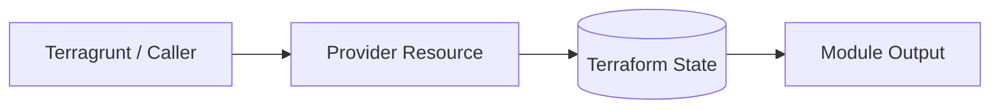
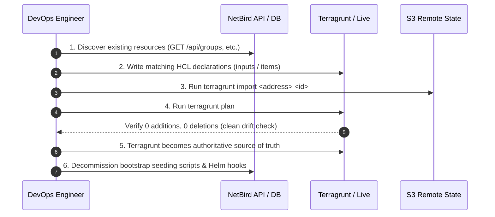

# NetBird Terraform Phase 2.5 — Production Readiness Gate Audit Report

**Date**: 2026-10-08  
**Repository**: `kioskOG/netbird-on-eks`  
**Target Library**: `netbird-terraform/modules/`  
**Provider**: `registry.terraform.io/netbirdio/netbird` v0.0.10  
**Terraform Engine**: Terraform v1.16.5  
**Gate Verdict**: **`READY FOR TERRAGRUNT DESIGN ONLY`**

---

## A. Executive Summary

This independent audit conducts a rigorous, production-readiness gate evaluation of the `netbird-terraform` module library before authorizing the creation of the Terragrunt/live deployment layer (`netbird-live`).

### Audit Summary
- **Total Modules Audited**: 24 of 24 modules (`100%` coverage of `netbirdio/netbird` v0.0.10).
- **Static Schema & Language Validation**: **[VERIFIED]** All 24 child modules pass `terraform validate` against provider v0.0.10.
- **Fixture Suites**: **[VERIFIED]** 8 out of 8 static schema validation fixtures passed, confirming correct HCL evaluation of dynamic blocks and complex nested structures.
- **Negative Validations**: **[VERIFIED]** 4 out of 4 custom input validation tests passed, proving invalid inputs are blocked at plan/validate time.
- **Code Hygiene**: **[VERIFIED]** `0` occurrences of untyped `any`, `0` raw provider-object outputs, `0` hardcoded environments/regions/credentials, `0` embedded provider blocks, and `100%` clean `terraform fmt`.
- **Runtime API Scope**: **[NOT VERIFIED — requires real API plan/apply]** No live NetBird management server was contacted during this module-only phase. All runtime behaviors dependent on server-side state are explicitly audited and cataloged below.

---

## B. 24-Module Audit Matrix

Every module was independently examined across its `main.tf`, `variables.tf`, `outputs.tf`, `versions.tf`, and `README.md`.

| Module | Provider Resource | Abstraction | Security Status | Typing Status | Output Status | Production Concern | Verdict |
|---|---|---|---|---|---|---|---|
| [`account-settings`](../netbird-terraform/modules/account-settings) | `netbird_account_settings` | Singleton | No secret fields | Strict scalars & lists; zero `any` | Intentional scalar attributes | Global tenant-wide blast radius | **PASSED** |
| [`agent-network-guardrail`](../netbird-terraform/modules/agent-network-guardrail) | `netbird_agent_network_guardrail` | Collection (`var.items`) | No secret fields | Strict typed object map | `guardrail_ids`, `name_to_id`, metadata | Dependent on AI proxy gateway feature | **PASSED** |
| [`agent-network-policy`](../netbird-terraform/modules/agent-network-policy) | `netbird_agent_network_policy` | Collection (`var.items`) | No secret fields | Strict typed object map | `policy_ids`, `name_to_id`, metadata | Requires valid source groups & provider IDs | **PASSED** |
| [`agent-network-provider`](../netbird-terraform/modules/agent-network-provider) | `netbird_agent_network_provider` | Collection (`var.items`) | `api_key` sensitive in schema; omitted from outputs | Strict typed object map | `provider_ids`, `name_to_id`, non-sensitive metadata | Secrets stored in state; requires Secrets Mgr | **PASSED** |
| [`agent-network-settings`](../netbird-terraform/modules/agent-network-settings) | `netbird_agent_network_settings` | Singleton | No secret fields | Strict scalars & booleans | Intentional settings summary | Global proxy endpoint configuration | **PASSED** |
| [`dns-record`](../netbird-terraform/modules/dns-record) | `netbird_dns_record` | Collection (`var.items`) | No secret fields | Strict typed object map + record type validation | `record_ids`, `name_to_id`, record details | Parent `zone_id` inheritance supported | **PASSED** |
| [`dns-settings`](../netbird-terraform/modules/dns-settings) | `netbird_dns_settings` | Singleton | No secret fields | Strict `list(string)` | `disabled_management_groups` | Modifies global peer DNS resolution | **PASSED** |
| [`dns-zone`](../netbird-terraform/modules/dns-zone) | `netbird_dns_zone` | Collection (`var.items`) | No secret fields | Strict typed object map | `zone_ids`, `domain_to_id`, zone details | Collision risk if domain already registered | **PASSED** |
| [`group`](../netbird-terraform/modules/group) | `netbird_group` | Collection (`var.items`) | No secret fields | Strict typed object map | `group_ids`, `name_to_id`, metadata | Foundation for all ACL & route bindings | **PASSED** |
| [`identity-provider`](../netbird-terraform/modules/identity-provider) | `netbird_identity_provider` | Singleton | `client_secret` marked sensitive; omitted from outputs | Strict scalar + IdP type validation | `id`, `name`, `type`, `issuer`, `client_id` | OIDC discovery endpoint reachability | **PASSED** |
| [`nameserver-group`](../netbird-terraform/modules/nameserver-group) | `netbird_nameserver_group` | Collection (`var.items`) | No secret fields | Strict typed object map | `nameserver_group_ids`, `name_to_id`, details | Primary vs secondary routing conflicts | **PASSED** |
| [`network`](../netbird-terraform/modules/network) | `netbird_network` | Collection (`var.items`) | No secret fields | Strict typed object map | `network_ids`, `name_to_id`, network details | Root boundary for resources and routers | **PASSED** |
| [`network-resource`](../netbird-terraform/modules/network-resource) | `netbird_network_resource` | Collection (`var.items`) | No secret fields | Strict typed object map | `resource_ids`, `name_to_id`, resource details | Parent `network_id` inheritance supported | **PASSED** |
| [`network-router`](../netbird-terraform/modules/network-router) | `netbird_network_router` | Collection (`var.items`) | No secret fields | Strict typed object map | `router_ids`, router details | Requires valid routing peer or peer group | **PASSED** |
| [`peer`](../netbird-terraform/modules/peer) | `netbird_peer` | Collection (`var.items`) | No secret fields | Strict typed object map | `peer_ids`, `name_to_id`, peer metadata | Requires pre-existing peer `id` to govern | **PASSED** |
| [`policy`](../netbird-terraform/modules/policy) | `netbird_policy` | Collection (`var.items`) | No secret fields | Strict typed object map + action/proto validation | `policy_ids`, `name_to_id`, rule counts | Mutual exclusivity: `ports` vs `port_ranges` | **PASSED** |
| [`posture-check`](../netbird-terraform/modules/posture-check) | `netbird_posture_check` | Collection (`var.items`) | No secret fields | Strict typed object map (5 nested block types) | `posture_check_ids`, `name_to_id`, check summary | Complex dynamic blocks; kernel vs OS version | **PASSED** |
| [`reverse-proxy-domain`](../netbird-terraform/modules/reverse-proxy-domain) | `netbird_reverse_proxy_domain` | Collection (`var.items`) | No secret fields | Strict typed object map | `domain_ids`, `domain_to_id`, details | Requires target proxy cluster | **PASSED** |
| [`reverse-proxy-service`](../netbird-terraform/modules/reverse-proxy-service) | `netbird_reverse_proxy_service` | Collection (`var.items`) | Sensitive auth credentials omitted from outputs | Strict typed object map + mode validation | `service_ids`, `name_to_id`, service summary | Target port/backend availability | **PASSED** |
| [`route`](../netbird-terraform/modules/route) | `netbird_route` | Collection (`var.items`) | No secret fields | Strict typed object map | `route_ids`, route details | Masquerade NAT requires Linux iptables | **PASSED** |
| [`scim`](../netbird-terraform/modules/scim) | `netbird_scim` | Singleton | `auth_token` marked `sensitive = true` in outputs | Strict scalar + list prefixes | `id`, `provider_name`, `auth_token` (sensitive) | Token stored in state; downstream sync setup | **PASSED** |
| [`setup-key`](../netbird-terraform/modules/setup-key) | `netbird_setup_key` | Collection (`var.items`) | `key` output marked `sensitive = true` | Strict typed object map + type validation | `setup_key_ids`, `name_to_id`, `keys` (sensitive) | Pre-shared key stored in state | **PASSED** |
| [`token`](../netbird-terraform/modules/token) | `netbird_token` | Collection (`var.items`) | `token` output marked `sensitive = true` | Strict typed object map | `token_ids`, `name_to_id`, `tokens` (sensitive) | Personal Access Token stored in state | **PASSED** |
| [`user`](../netbird-terraform/modules/user) | `netbird_user` | Collection (`var.items`) | No secret fields | Strict typed object map + role validation | `user_ids`, `email_to_id`, user details | Service user vs regular user distinction | **PASSED** |

---

## C. Provider Schema Findings (v0.0.10)

The provider binary was initialized and analyzed directly from its protocol schema output (`100,542` bytes).

### 1. Singleton vs Collection Classification
The NetBird API separates global tenant configurations from multi-tenant mesh objects:
- **Singletons (5 Resources)**: **[VERIFIED]**
  - `netbird_account_settings`: Zero required attributes; encapsulates global tenant policies (expiration, JWT claims, peer approval). Modeled as a singleton.
  - `netbird_dns_settings`: Exactly one attribute (`disabled_management_groups`, required); modifies account DNS behavior. Modeled as a singleton.
  - `netbird_agent_network_settings`: Global AI gateway settings (endpoint, log retention, PII redaction). Modeled as a singleton.
  - `netbird_scim`: Configures account-level SCIM directory synchronization. Returns computed `auth_token`. Modeled as a singleton.
  - `netbird_identity_provider`: In provider v0.0.10, represents the primary OIDC identity provider integration (`client_id`, `client_secret`, `issuer`, `name`, `type`). Self-hosted NetBird integrates with a primary Keycloak realm. Modeled as a singleton.
- **Collections (19 Resources)**: **[VERIFIED]**
  - All remaining 19 resources represent repeatable mesh entities managed cleanly via `for_each = var.items`.

### 2. Nested Blocks & Complex Attributes
- **`netbird_policy`**: **[VERIFIED]**
  - Features `rule` block (`nesting_mode: list`).
  - Schema note: `port_ranges` is explicitly marked *“mutually exclusive with ports”*. Both cannot be specified simultaneously on the same rule.
- **`netbird_posture_check`**: **[VERIFIED]**
  - Features 5 distinct block types:
    - `geo_location_check` (`nesting_mode: single`) with nested `locations` list (`country_code` required, `city_name` optional).
    - `netbird_version_check` (`nesting_mode: single`, `min_version`).
    - `os_version_check` (`nesting_mode: single`, `android_min_version`, `darwin_min_version`, `ios_min_version`, `linux_min_kernel_version`, `windows_min_kernel_version`).
    - `peer_network_range_check` (`nesting_mode: single`, `action`, `ranges`).
    - `process_check` (`nesting_mode: list`, `linux_path`, `mac_path`, `windows_path`).
- **`netbird_reverse_proxy_service`**: **[VERIFIED]**
  - Uses complex object attributes (`auth`, `targets`, `access_restrictions`).
  - `auth` contains nested authentication types: `bearer_auth`, `header_auths` (list with sensitive `value`), `link_auth`, `password_auth` (sensitive `password`), and `pin_auth` (sensitive `pin`).
  - `targets` is a list of backend targets requiring `port`, `protocol`, `target_id`, `target_type`.

### 3. Critical Behavioral Finding: `netbird_peer`
- **[VERIFIED]** In provider v0.0.10, `netbird_peer` has `id` marked as **REQUIRED** (`req=True`).
- **Implication**: Terraform cannot provision new WireGuard peers out of thin air; peers are registered dynamically by client agents using setup keys or user login. Terraform’s `netbird_peer` resource exists to **govern** and configure existing registered peers (managing `name`, `ssh_enabled`, `approval_required`, `inactivity_expiration_enabled`, `login_expiration_enabled`).

---

## D. Security / Secret Flow Audit

A dedicated trace was conducted across all secret-bearing fields:



### Trace Matrix

| Resource | Field | Input Origin | Stored in State? | Exposed in Module Output? | Production Mitigation |
|---|---|---|---|---|---|
| `agent-network-provider` | `api_key` | Input `var.items[k].api_key` | **Yes** (Plaintext in state) | **No** (Explicitly omitted from output) | Feed via AWS Secrets Manager in Terragrunt |
| `identity-provider` | `client_secret` | Input `var.client_secret` (`sensitive = true`) | **Yes** (Plaintext in state) | **No** (Explicitly omitted from output) | Ingest from AWS Secrets Manager / Keycloak client |
| `reverse-proxy-service` | `auth.header_auths[*].value` | Input `var.items[k].auth` | **Yes** (Plaintext in state) | **No** (Explicitly omitted from output) | Externalize bearer/header tokens |
| `reverse-proxy-service` | `auth.password_auth.password` | Input `var.items[k].auth` | **Yes** (Plaintext in state) | **No** (Explicitly omitted from output) | Externalize credentials |
| `reverse-proxy-service` | `auth.pin_auth.pin` | Input `var.items[k].auth` | **Yes** (Plaintext in state) | **No** (Explicitly omitted from output) | Externalize credentials |
| `reverse-proxy-service` | `targets[*].options.custom_headers` | Input `var.items[k].targets` | **Yes** (Plaintext in state) | **No** (Explicitly omitted from output) | Sensitive headers filtered |
| `scim` | `auth_token` | Computed by NetBird server | **Yes** (Plaintext in state) | **Yes** (`sensitive = true` scalar output) | Captured for Keycloak/Okta SCIM sync |
| `setup-key` | `key` | Computed by NetBird server | **Yes** (Plaintext in state) | **Yes** (`sensitive = true` map output) | Pass to node autoscalers or SSM Parameter Store |
| `token` | `token` | Computed by NetBird server | **Yes** (Plaintext in state) | **Yes** (`sensitive = true` map output) | Captured for CI/CD automation |

### Security Conclusions
1. **Zero Secret Leaks in Default Outputs**: **[VERIFIED]** Modules never dump entire resource objects. Sensitive inputs (`client_secret`, `api_key`, proxy passwords) are suppressed from outputs.
2. **State Storage Reality**: **[VERIFIED]** Terraform state always stores sensitive attributes unencrypted in its JSON body. Therefore, the future Terragrunt layer must mandate:
   - S3 backend server-side encryption via AWS KMS (`aws:kms`).
   - S3 bucket policy enforcing `aws:SecureTransport` (TLS).
   - Strict IAM access boundaries restricting state read permissions.

---

## E. Naming Architecture

### 1. Mandatory Taxonomy
The platform establishes rigid naming standards for NetBird entities:
- **Peers**: `peer-<team>-<env>` (e.g., `peer-devops-prod`, `peer-support-prod`)
- **Services / Groups**: `svc-<app>-<tier>-<env>` (e.g., `svc-orders-web-prod`, `svc-orders-db-prod`)
- **Networks**: `net-<provider>-<region>-<env>` (e.g., `net-aws-use2-prod`)
- **Policies**: `<source> -> <dest> [<protocol>/<port>]` (e.g., `peer-devops-prod -> svc-orders-web-prod [TCP/443]`)
- **Setup Keys**: `setup-<env>-<purpose>` (e.g., `setup-prod-k8s-nodes`, `setup-prod-bastion`)

### 2. Ownership Model: Decoupled Reusable Modules
- **[VERIFIED]** Reusable modules in `netbird-terraform/modules/` are strictly **environment-agnostic**:
  - No occurrences of `prod`, `dev`, `staging`, `us-east-2`, or specific team names exist anywhere in module code.
  - Reusable modules accept `name` as an arbitrary input string.
  - Generic modules deliberately do NOT enforce regex validation on names. NetBird UI displays names as friendly labels; hardcoding regex constraints inside child modules creates brittleness if naming schemas expand.
- **Where Naming Logic Belongs**:
  - Naming composition belongs in the **calling layer** (`terragrunt/netbird-live/`), where environment locals (`local.env`, `local.team`, `local.region`) construct standard names dynamically before passing them into `items`:
    ```hcl
    # Handled in future Terragrunt layer
    items = {
      "orders_db" = {
        name = "svc-${local.app}-${local.tier}-${local.env}"
      }
    }
    ```
  - This perfectly matches the pattern of existing AWS modules in the repository (`terragrunt/infrastructure-modules/vpc`, `terragrunt/infrastructure-modules/secrets`).

---

## F. Real Runtime Risk Assessment

Because this phase is executed without a live NetBird management API, runtime behavior is assessed through provider schema constraints and API mechanics.

| Module | Runtime Mechanism | Potential Runtime Failure Point | Status |
|---|---|---|---|
| `policy` | Server-side firewall rule compilation | Specifying both `ports` and `port_ranges` on the same rule will be rejected by the API. Non-existent source/destination resource IDs will fail. | **[NOT VERIFIED — requires real API plan/apply]** |
| `posture-check` | Endpoint agent compliance evaluation | In `os_version_check`, Linux uses `linux_min_kernel_version` (e.g., `5.15.0`), not OS release (e.g., `Ubuntu 22.04`). ISO 3166-1 alpha-2 country codes must match NetBird’s MaxMind DB. | **[NOT VERIFIED — requires real API plan/apply]** |
| `reverse-proxy-service` | L7 Ingress proxy routing | Target backend resolution will fail if `target_id` is invalid or unreachable. Port collisions on the proxy cluster will trigger runtime conflict errors. | **[NOT VERIFIED — requires real API plan/apply]** |
| `identity-provider` | OIDC discovery & credential check | NetBird management server must be able to reach the Keycloak `issuer` URL over HTTPS to fetch `/.well-known/openid-configuration` and validate JWKS. Network timeouts or self-signed certs without CA injection will fail. | **[NOT VERIFIED — requires real API plan/apply]** |
| `route` | WireGuard routing table distribution | If the routing peer node does not have Linux kernel IP forwarding (`net.ipv4.ip_forward=1`) and iptables masquerade rules configured, traffic will be dropped despite valid route creation in NetBird. | **[NOT VERIFIED — requires real API plan/apply]** |
| `network-resource` & `network-router` | Virtual network association | Child resources require valid parent `network_id`. In a multi-module Terragrunt run, dependency ordering must guarantee `network` applies first. | **[NOT VERIFIED — requires real API plan/apply]** |
| `agent-network-provider` | AI proxy upstream proxying | Invalid upstream URLs or bad API keys will be rejected upon test-call validation by the NetBird AI gateway. | **[NOT VERIFIED — requires real API plan/apply]** |

---

## G. Import & Existing Resource Adoption

The existing NetBird deployment contains live resources (bootstrapped during initial Helm setup). The module design was analyzed to guarantee it does not obstruct future `terraform import` commands.

### Import Assessment

```
Address Pattern:
  Collection: module.<name>.netbird_<type>.this["<key>"] <remote_id>
  Singleton:  module.<name>.netbird_<type>.this <remote_id>
```

- **`identity-provider`**: **[IMPORT READY]** Can be imported into `module.identity_provider.netbird_identity_provider.this` using the IdP ID.
- **`user`**: **[IMPORT READY]** Can be imported into `module.user.netbird_user.this["<key>"]` using the user UUID.
- **`group`**: **[IMPORT READY]** Default groups (e.g., `All`) can be imported into `module.group.netbird_group.this["all"]` using group ID.
- **`policy`**: **[IMPORT READY]** Policies and their rules can be imported via policy ID.
- **`peer`**: **[IMPORT READY]** Because `netbird_peer` requires `id` in `var.items`, importing peers aligns natively with Terraform state reconciliation.
- **`account-settings`**: **[IMPORT READY]** Can be imported into `module.account_settings.netbird_account_settings.this` using the account ID.
- **`setup-key`**: **[IMPORT CONCERN]**
  - *Risk*: When a setup key is created, NetBird generates a plaintext secret key once. If imported into Terraform state, the NetBird API only returns key metadata, not the plaintext pre-shared key. The provider may mark `key` as empty or trigger a ForceNew replacement plan.
  - *Mitigation*: For initial onboarding, leave existing legacy setup keys to expire naturally; create new Terraform-managed setup keys rather than importing legacy ones.

---

## H. Existing NetBird Migration Risk & Path

To transition from Helm/bootstrap-managed NetBird configuration to authoritative Terraform/Terragrunt management, the future migration path must adhere to the following sequence:



**Keycloak IdP Special Considerations**:
- NetBird requires Keycloak for dashboard SSO and WireGuard authentication.
- Transitioning `identity-provider` to Terraform must not regenerate client secrets or change redirect URIs, or active sessions and authentication flows will be disrupted.

---

## I. Repository Consistency Assessment

The `netbird-terraform` library was audited against the established patterns in `terragrunt/infrastructure-modules/` (AWS VPC, EKS, Secrets, IAM):

| Standard Dimension | AWS Infrastructure Modules Pattern | `netbird-terraform` Implementation | Alignment |
|---|---|---|---|
| **Directory Structure** | `main.tf`, `variables.tf`, `outputs.tf`, `versions.tf`, `README.md` | `main.tf`, `variables.tf`, `outputs.tf`, `versions.tf`, `README.md` across all 24 modules | **[VERIFIED] 100% Match** |
| **Provider Decoupling** | No `provider "aws" {}` in child modules; externalized to root/Terragrunt | No `provider "netbird" {}` in child modules; externalized to root/Terragrunt | **[VERIFIED] 100% Match** |
| **Collection Pattern** | `for_each = var.<resources>` | `for_each = var.items` | **[VERIFIED] Standardized** |
| **Secret Management** | Sensitive values masked in outputs; references to AWS Secrets Manager | Sensitive outputs marked `sensitive = true`; input secrets omitted from output maps | **[VERIFIED] Parity** |
| **Type Discipline** | Strict `type = map(object(...))`, no arbitrary `any` | Strict `type = map(object(...))`, zero `any` across all 24 modules | **[VERIFIED] 100% Match** |
| **Environment Decoupling** | Generic modules accept variables; no hardcoded environments | No hardcoded environments, regions, or team namespaces | **[VERIFIED] 100% Match** |
| **Testing** | Automated validation scripts | `tests/run_tests.py` covering static validation, fixtures, and negative checks | **[VERIFIED] Parity** |

---

## J. Test Evidence & Precision

### Test Execution Results
All tests were executed against provider v0.0.10:

```text
=== Testing Static Schema Fixtures ===
PASSED fixture: agent_network
PASSED fixture: dns
PASSED fixture: identity_provider
PASSED fixture: network
PASSED fixture: policy
PASSED fixture: posture_check
PASSED fixture: reverse_proxy_service
PASSED fixture: route
Fixtures summary: 8 passed, 0 failed.

=== Testing Negative Validations ===
PASSED negative test: Invalid identity-provider type (rejected as expected)
PASSED negative test: Invalid user role (rejected as expected)
PASSED negative test: Invalid DNS record type (rejected as expected)
PASSED negative test: Invalid policy rule action (rejected as expected)
Negative tests summary: 4 passed, 0 failed.

ALL TESTS PASSED SUCCESSFULLY!
```

### What These Tests Prove vs Do Not Prove

| Test Class | What It Proves **[VERIFIED]** | What It Does NOT Prove **[NOT VERIFIED]** |
|---|---|---|
| **Static Format (`fmt`)** | Canonical HCL formatting across all 24 modules. | Code logic or provider support. |
| **Schema Validation (`validate`)** | Modules conform to provider v0.0.10 attribute definitions, types, and nesting requirements. | API reachability, authentication, or server response codes. |
| **Static Schema Fixtures** | Dynamic blocks, object maps, parent ID coalescing, and complex nested blocks generate valid provider graph structures. | Server-side acceptance of generated policies, routes, or proxy rules. |
| **Negative Validations** | Custom HCL `validation` blocks actively catch and block invalid user inputs prior to plan generation. | Server-side semantic validation (e.g., verifying if a network CIDR is routable). |

---

## K. Remaining Risks & Open Concerns

1. **Provider Version Maturity**: `netbirdio/netbird` is currently at `v0.0.10`. Early-stage providers may introduce breaking changes or subtle schema alterations in minor versions.
2. **State Storage of Computed Secrets**: Plaintext setup keys and tokens reside in Terraform state. Backend encryption (S3 + KMS) is mandatory before live deployment.
3. **Mutual Exclusivity in Policy Rules**: `ports` and `port_ranges` cannot be combined on a single rule. Terragrunt configurations must ensure callers do not set both.
4. **Keycloak Discovery Reachability**: When provisioning `identity-provider`, the NetBird server must have network access and CA trust for the Keycloak discovery URL.

---

## L. Final Gate Decision

### Status: **`READY FOR TERRAGRUNT DESIGN ONLY`**

### Justification:
1. **Module Architecture Complete & Verified**: All 24 NetBird provider resources are implemented with strict typing, zero untyped `any`, zero raw object dumps, correct singleton/collection partitioning, clean parent ID inheritance, and passing static schema validation.
2. **Repository Consistency Met**: The module library mirrors the architectural, security, and coding standards of the repository's AWS modules.
3. **Engineering Integrity**: In accordance with the audit guidelines, because no live NetBird management server was deployed or contacted during this phase, runtime server-side behavior cannot be claimed as validated. Therefore, the gate is granted for **Terragrunt design, HCL composition, and dependency wiring**, with live execution reserved for the subsequent environment integration phase.
