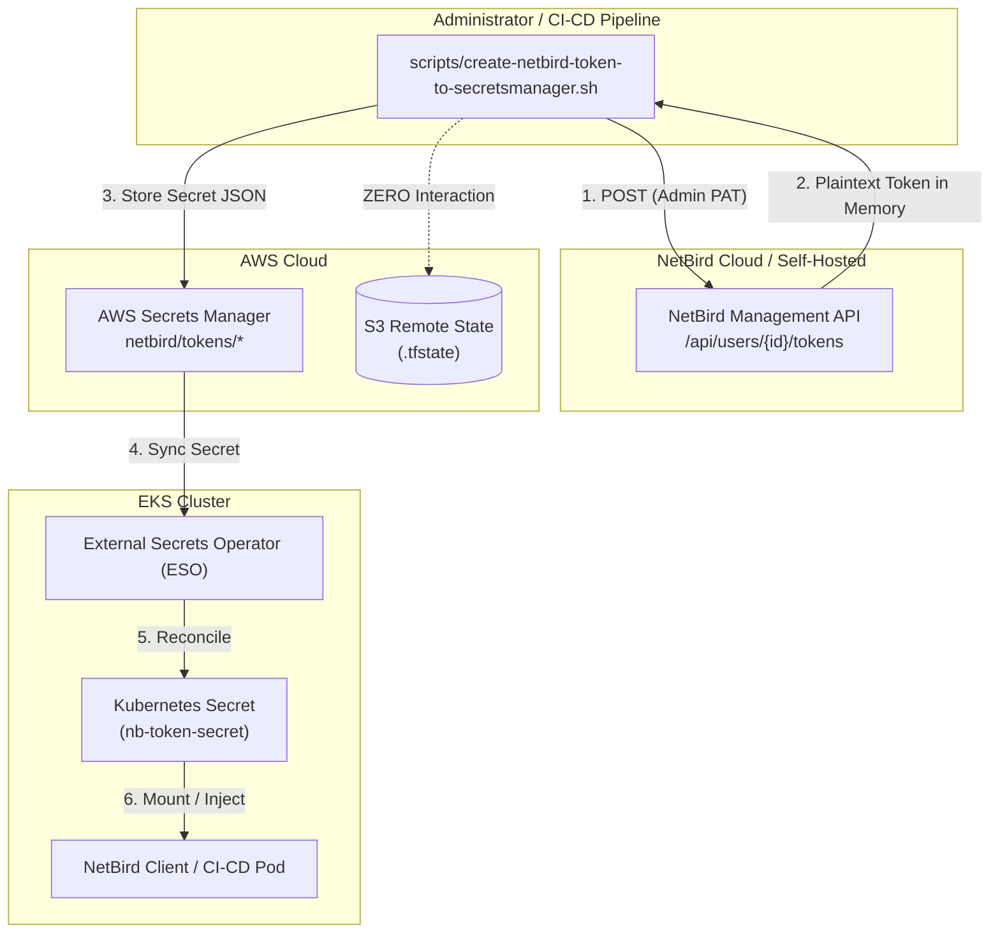
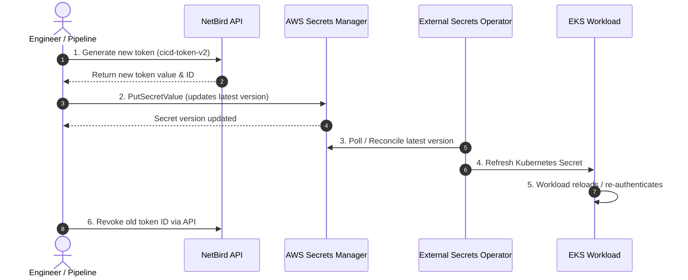

# NetBird Secrets Management Guide

This guide details the security model, operational workflows, and automation scripts used to manage **NetBird Personal Access Tokens (PATs)** and sensitive credentials within this repository without leaking plaintext secrets into Terraform state files.

---

## 1. Architecture & Threat Model

### The Problem: Secrets in Terraform State
By design, HashiCorp Terraform stores all managed resource inputs and outputs in `.tfstate` files in plaintext. If tokens are provisioned using native Terraform resources (`netbird_token` and `aws_secretsmanager_secret_version`), the sensitive token string is permanently written to the S3 remote state backend.

### The Solution: Out-of-Band Generation into AWS Secrets Manager
To achieve **Zero Secret Exposure in `.tfstate`**, tokens are provisioned via an automated out-of-band workflow that interacts directly with the NetBird Management API and pipes credentials straight into **AWS Secrets Manager**.



> [!IMPORTANT]
> **Zero State Exposure Guarantee**: Neither Terraform nor Terragrunt track the plaintext tokens created by this pipeline. S3 state files remain 100% free of sensitive credentials.

---

## 2. Prerequisites

Ensure the following command-line utilities are installed and available in your environment:

| Tool | Minimum Version | Purpose |
| :--- | :--- | :--- |
| `bash` | 4.0+ | Script execution environment |
| `curl` | Any recent | NetBird Management REST API client |
| `jq` | 1.6+ | JSON payload construction and response parsing |
| `aws` | AWS CLI v2 | AWS Secrets Manager API operations |

### Required Environment Variables & Permissions

```bash
# NetBird Configuration
export NB_MANAGEMENT_URL="https://netbird.REPLACE_ME_DOMAIN"   # Base URL of NetBird Management
export NB_PAT="<your-admin-personal-access-token>"       # Admin PAT with permission to generate user tokens

# AWS Configuration
export AWS_REGION="us-east-2"                           # Target AWS region
export AWS_PROFILE="<your-aws-profile>"                 # AWS profile with SecretsManager access
```

#### Required AWS IAM Permissions
The executing role or user must possess the following IAM actions on the target secret prefix (`arn:aws:secretsmanager:*:*:secret:netbird/*`):
- `secretsmanager:DescribeSecret`
- `secretsmanager:CreateSecret`
- `secretsmanager:PutSecretValue`
- `secretsmanager:RestoreSecret`
- `secretsmanager:TagResource`

---

## 3. Provisioning Tokens

The repository provides an automated script at [scripts/create-netbird-token-to-secretsmanager.sh](../scripts/create-netbird-token-to-secretsmanager.sh).

### Step 3.1: Discover the NetBird User ID

Tokens must be attached to a specific NetBird user (e.g., service user, CI/CD bot, or admin).

You can find the User ID from:
1. The NetBird Web UI: **Settings** &rarr; **Users** &rarr; Select User &rarr; View User ID.
2. Terraform output from the `users` unit:
   ```bash
   cd terragrunt/netbird-live/accounts/netbird/dev/users
   terragrunt output user_ids
   ```

### Step 3.2: Run the Provisioning Script

Execute the script with the user ID, token name, and optional target secret name:

```bash
./scripts/create-netbird-token-to-secretsmanager.sh \
  --user-id "<service-user-id>" \
  --name "cicd-pipeline-token" \
  --secret-name "netbird/tokens/cicd-pat" \
  --expires-in 90 \
  --region "us-east-2"
```

### CLI Parameters Reference

| Flag | Long Flag | Description | Default |
| :--- | :--- | :--- | :--- |
| `-u` | `--user-id` | **Required.** NetBird User ID to attach token to | _None_ |
| `-n` | `--name` | **Required.** Descriptive name for the token | _None_ |
| `-s` | `--secret-name` | AWS Secrets Manager secret name | `netbird/tokens/<name>` |
| `-e` | `--expires-in` | Expiration time in days | `90` |
| `-r` | `--region` | AWS Region | `$AWS_REGION` or `us-east-2` |
| `-m` | `--url` | NetBird Management Server base URL | `$NB_MANAGEMENT_URL` |
| `-t` | `--token` | Admin PAT for NetBird API | `$NB_PAT` |
| `-h` | `--help` | Display usage instructions | _None_ |

### Step 3.3: Secret JSON Schema in AWS Secrets Manager

The secret is stored as structured JSON with the following schema:

```json
{
  "NB_PAT": "nbp_<redacted-40-char-token>",
  "TOKEN_ID": "<token-id>",
  "USER_ID": "<service-user-id>",
  "TOKEN_NAME": "cicd-pipeline-token",
  "MANAGEMENT_URL": "https://netbird.REPLACE_ME_DOMAIN"
}
```

---

## 4. Verifying the Secret

Verify that the secret was successfully written to AWS Secrets Manager using the AWS CLI:

```bash
# Check secret metadata
aws secretsmanager describe-secret \
  --secret-id "netbird/tokens/cicd-pat" \
  --region "us-east-2"

# Inspect the stored secret value (decrypts with KMS)
aws secretsmanager get-secret-value \
  --secret-id "netbird/tokens/cicd-pat" \
  --region "us-east-2" \
  --query "SecretString" \
  --output text | jq .
```

---

## 5. Kubernetes Integration (External Secrets Operator)

To consume the generated token inside an EKS cluster without manual intervention, configure the **External Secrets Operator (ESO)**.

### 5.1 ClusterSecretStore Manifest

```yaml
apiVersion: external-secrets.io/v1beta1
kind: ClusterSecretStore
metadata:
  name: aws-secrets-manager
spec:
  provider:
    aws:
      service: SecretsManager
      region: us-east-2
      auth:
        jwt:
          serviceAccountRef:
            name: external-secrets-sa
            namespace: external-secrets
```

### 5.2 ExternalSecret Manifest

```yaml
apiVersion: external-secrets.io/v1beta1
kind: ExternalSecret
metadata:
  name: netbird-cicd-pat
  namespace: netbird-system
spec:
  refreshInterval: 1h
  secretStoreRef:
    name: aws-secrets-manager
    kind: ClusterSecretStore
  target:
    name: netbird-cicd-pat
    creationPolicy: Owner
  data:
    - secretKey: NB_PAT
      remoteRef:
        key: netbird/tokens/cicd-pat
        property: NB_PAT
    - secretKey: MANAGEMENT_URL
      remoteRef:
        key: netbird/tokens/cicd-pat
        property: MANAGEMENT_URL
```

Workloads can then consume `NB_PAT` directly from the generated Kubernetes secret:

```yaml
env:
  - name: NB_PAT
    valueFrom:
      secretKeyRef:
        name: netbird-cicd-pat
        key: NB_PAT
```

---

## 6. Token Rotation Workflow

NetBird tokens should be rotated regularly (e.g., every 60–90 days). The rotation workflow guarantees zero downtime:



### Step-by-Step Rotation

1. **Generate and publish the new version**:
   ```bash
   ./scripts/create-netbird-token-to-secretsmanager.sh \
     --user-id "<service-user-id>" \
     --name "cicd-pipeline-token-v2" \
     --secret-name "netbird/tokens/cicd-pat" \
     --expires-in 90
   ```
   *Note: Using the same `--secret-name` creates a new version in Secrets Manager while keeping the ARN and integration intact.*

2. **Wait for ESO sync**:
   Check that Kubernetes has picked up the new token:
   ```bash
   kubectl -n netbird-system get externalsecret netbird-cicd-pat
   ```

3. **Revoke the old token in NetBird**:
   Call the NetBird API to delete the previous token ID:
   ```bash
   curl -s -X DELETE \
     -H "Authorization: Token ${NB_PAT}" \
     "https://netbird.REPLACE_ME_DOMAIN/api/users/${USER_ID}/tokens/${OLD_TOKEN_ID}"
   ```

---

## 7. Cleaning Up Legacy Tokens from Terraform State

If a token was previously generated through Terraform (e.g., via the [tokens unit](../terragrunt/netbird-live/accounts/netbird/dev/tokens/terragrunt.hcl)), clean it up to purge all sensitive attributes from `.tfstate`:

1. Run `terragrunt destroy` in the tokens unit directory:
   ```bash
   cd ./terragrunt/netbird-live/accounts/netbird/dev/tokens
   terragrunt destroy
   ```

2. Verify that the tokens configuration is empty in [tokens/terragrunt.hcl](../terragrunt/netbird-live/accounts/netbird/dev/tokens/terragrunt.hcl):
   ```hcl
   inputs = {
     items = {}
   }
   ```

3. Keep Terraform strictly dedicated to declarative network assets:
   - Groups ([groups/terragrunt.hcl](../terragrunt/netbird-live/accounts/netbird/dev/groups/terragrunt.hcl))
   - Access Policies ([policies/terragrunt.hcl](../terragrunt/netbird-live/accounts/netbird/dev/policies/terragrunt.hcl))
   - Routes ([routes/terragrunt.hcl](../terragrunt/netbird-live/accounts/netbird/dev/routes/terragrunt.hcl))
   - DNS Zones & Records ([dns-zones/terragrunt.hcl](../terragrunt/netbird-live/accounts/netbird/dev/dns-zones/terragrunt.hcl))
   - Users ([users/terragrunt.hcl](../terragrunt/netbird-live/accounts/netbird/dev/users/terragrunt.hcl))

---

## 8. Troubleshooting

### Issue 1: `Error: Failed to retrieve token from NetBird API`
- **Cause**: Admin PAT (`NB_PAT`) is invalid, expired, or does not have sufficient admin permissions to generate tokens for other users.
- **Fix**: Verify `NB_PAT` by running a test request:
  ```bash
  curl -s -f -H "Authorization: Token ${NB_PAT}" "https://netbird.REPLACE_ME_DOMAIN/api/users" | jq .
  ```

### Issue 2: `InvalidRequestException: Operation not allowed on secret scheduled for deletion`
- **Cause**: The secret was previously destroyed or deleted with a retention period.
- **Fix**: The script handles this automatically by running `aws secretsmanager restore-secret`. You can also manually restore it:
  ```bash
  aws secretsmanager restore-secret --secret-id "netbird/tokens/cicd-pat" --region "us-east-2"
  ```

### Issue 3: `AccessDeniedException` on AWS Secrets Manager
- **Cause**: Active AWS credentials lack permissions to `create-secret` or `put-secret-value`.
- **Fix**: Verify your caller identity:
  ```bash
  aws sts get-caller-identity
  ```
  Ensure your IAM policy allows `secretsmanager:*` on `netbird/tokens/*`.